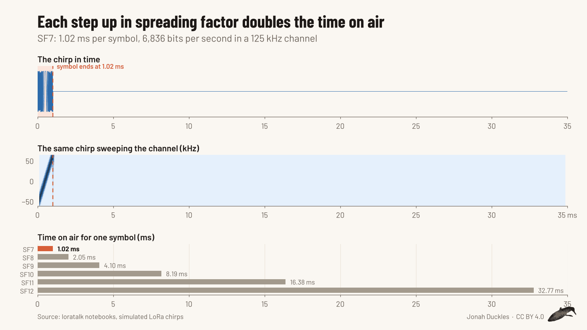
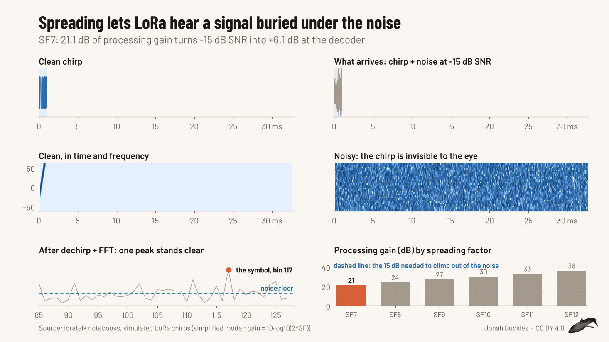

## Lora Talk given at ZL4AA on April 29th, 2026 by ZL4EKA

There are two Jupyter Notebooks here so others can play around with the graphics I built. These helped me to understand and explain some of the parameters in LoRa better and explain them for the purposes of this talk. 

The presentation slides are [available here](https://jduckles.github.io/loratalk/lora_presentation.html) and source for them in the associated `.md` file in the repo. 

The figures in `figures/` are drawn by `lora_figures.py` in the [baleen](https://github.com/jduckles/visual) style. `python3 lora_figures.py` redraws all of them, and `python3 lora_figures.py sf_tradeoff` redraws one. `./build` redraws the figures and the slides; `./build pdf` adds a PDF where Chrome is installed. Photos, maps and screenshots are in `images/`.

Click on Launch Binder links below to open in MyBinder.org and mess around with the Python. 

- Open Spreading Factor explainer graphic Jupyter Notebook - 

- Open Spreading Factor Gain explainer graphic Jupyter Notebook - 

